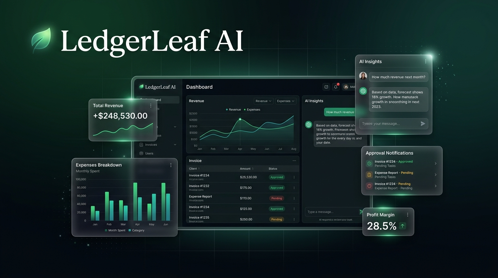

<p align="center">
  
</p>

<p align="center">
  <a href="https://ledgerleaf-ai.vercel.app"></a>
</p>

<p align="center">
  
  
  
  
  
  
  
  
</p>

<h1 align="center">🍃 LedgerLeaf AI</h1>
<h3 align="center"><em>Less paperwork. Clearer finances. Smarter decisions.</em></h3>

<p align="center">
  AI-powered financial operations platform for agencies and service businesses.<br/>
  Manage invoices, track expenses, and make smarter financial decisions<br/>
  with AI-assisted workflows and human approval controls.
</p>

<p align="center">
  <strong>AI proposes. Humans approve.</strong>
</p>

---

## 🌐 Live Demo

| | URL |
|---|---|
| 🖥️ **Frontend App** | **[https://ledgerleaf-ai.vercel.app](https://ledgerleaf-ai.vercel.app)** |
| 📡 **Backend API Docs** | Deploy to Railway/Render ([guide](docs/DEPLOYMENT.md)) |

> **Try it out:** Register → Create a workspace → Explore the dashboard, invoices, expenses, AI assistant, and more.

---

## ✨ Features at a Glance

<table>
<tr>
<td width="50%">

### 🔐 Authentication & Multi-Tenancy
- JWT-based registration & login
- bcrypt password hashing
- Organization-scoped data isolation
- Role-based access (Owner / Manager / Member)
- Cross-tenant access protection (verified by tests)

### 📄 Invoice Management
- Create invoices with unlimited line items
- Decimal-safe tax & discount calculations
- Issue → Payment → Paid lifecycle
- Partial & full payment support
- Idempotency keys prevent double-charging
- Overpayment rejection

### 💰 Expense Tracking
- Full CRUD with status transitions
- Category-based organization
- Vendor tracking & receipt URLs
- Expense approval workflows

</td>
<td width="50%">

### 🤖 AI Finance Assistant
- Natural language chat interface
- Demo mode (works without API key)
- Ready for OpenAI GPT-4o integration
- Answers grounded in actual records

### ✅ Approval Engine
- SHA-256 payload hash verification
- Risk level classification (low/medium/high)
- Configurable expiry times
- Approve/reject with reasons
- Tamper-proof execution

### 📊 Financial Dashboard
- Revenue, expenses, net income metrics
- Outstanding receivables tracking
- Monthly revenue trend charts (Recharts)
- Expense breakdown by category (pie chart)
- Real-time computed data from database

</td>
</tr>
</table>

### Full Feature Matrix

| Feature | Status | Description |
|---------|--------|-------------|
| 🔐 Authentication | ✅ Complete | JWT + bcrypt, register/login/profile |
| 🏢 Multi-Tenancy | ✅ Complete | Org-scoped isolation, role-based access |
| 👥 Client Management | ✅ Complete | Full CRUD, search, pagination |
| 📄 Invoices | ✅ Complete | Line items, tax/discount math, issue/pay workflows |
| 💳 Payments | ✅ Complete | Partial/full, idempotency, overpayment prevention |
| 📊 Dashboard | ✅ Complete | Revenue charts, expense breakdowns, trends |
| 💰 Expenses | ✅ Complete | CRUD, status transitions, categories |
| 🤖 AI Assistant | ✅ UI Complete | Chat interface, demo mode, OpenAI-ready |
| ✅ Approval Engine | ✅ Complete | SHA-256 hashing, risk levels, expiry |
| 📈 Reports | ✅ Complete | P&L, financial summaries from real data |
| 💹 Cash Flow | ✅ UI Complete | Rule-based projections, scenario modeling |
| 📁 Documents | ✅ UI Complete | Upload interface, storage-ready |
| 👥 Team | ✅ Complete | Member listing, role badges |
| ⚙️ Settings | ✅ Complete | Profile, workspace, security preferences |
| 💳 Billing | ✅ UI Complete | Subscription management placeholder |
| 🔄 Transactions | ✅ Complete | Full transaction ledger |
| 💵 Receivables | ✅ Complete | Accounts receivable tracking |

---

## 🏗️ Architecture

```
┌──────────────────────────────┐
│       Vercel CDN (HTTPS)     │
│    ┌──────────────────────┐  │
│    │   Next.js 16 + React │  │     JSON API       ┌──────────────────┐
│    │   TypeScript + TW 4  │──┼──────────────────── │  FastAPI Backend │
│    │   Recharts + Lucide  │  │                     │  Python 3.13     │
│    └──────────────────────┘  │                     │  SQLAlchemy 2.1  │
└──────────────────────────────┘                     │  Pydantic V2     │
                                                     └────────┬─────────┘
                                                              │
                                                     ┌────────▼─────────┐
                                                     │  PostgreSQL/     │
                                                     │  SQLite (dev)    │
                                                     └──────────────────┘
```

### Project Structure

```
LedgerLeaf-AI/
├── 📁 backend/                     # FastAPI Python Backend
│   ├── app/
│   │   ├── api/v1/                # REST API routes
│   │   │   ├── auth.py            # 🔐 Auth & Organizations
│   │   │   ├── clients.py         # 👥 Client CRUD
│   │   │   ├── invoices.py        # 📄 Invoices & Payments
│   │   │   ├── expenses.py        # 💰 Expense Management
│   │   │   ├── dashboard.py       # 📊 Financial Analytics
│   │   │   ├── approvals.py       # ✅ Approval Engine
│   │   │   ├── transactions.py    # 🔄 Transaction Ledger
│   │   │   └── categories.py      # 📂 Category Management
│   │   ├── core/                  # Config, Database, Security
│   │   ├── models/                # SQLAlchemy ORM Models
│   │   ├── schemas/               # Pydantic Validation Schemas
│   │   ├── ai/                    # AI Assistant Module
│   │   ├── services/              # Business Logic Services
│   │   └── workers/               # Background Workers
│   ├── tests/                     # Pytest Suite (20 tests)
│   │   ├── conftest.py            # Test fixtures & setup
│   │   └── test_api.py            # Integration tests
│   └── requirements.txt
│
├── 📁 frontend/                    # Next.js 16 Frontend
│   └── src/app/
│       ├── page.tsx               # 🌿 Landing Page
│       ├── login/                 # 🔑 Authentication
│       ├── register/              # 📝 Registration
│       ├── onboarding/            # 🚀 Workspace Setup
│       └── dashboard/
│           ├── page.tsx           # 📊 Financial Overview
│           ├── layout.tsx         # 🧭 Sidebar Navigation
│           ├── assistant/         # 🤖 AI Chat Interface
│           ├── invoices/          # 📄 Invoice Management
│           ├── clients/           # 👥 Client Directory
│           ├── expenses/          # 💰 Expense Tracker
│           ├── transactions/      # 🔄 Transaction Ledger
│           ├── approvals/         # ✅ Approval Queue
│           ├── receivables/       # 💵 AR Tracking
│           ├── cashflow/          # 💹 Cash Flow Forecast
│           ├── reports/           # 📈 Financial Reports
│           ├── documents/         # 📁 Document Upload
│           ├── team/              # 👥 Team Members
│           ├── billing/           # 💳 Subscription
│           └── settings/          # ⚙️ Preferences
│
├── 📁 docs/                        # Documentation
│   ├── DEPLOYMENT.md              # 🚀 Deployment Guide
│   ├── ARCHITECTURE.md            # 🏗️ Architecture Decisions
│   ├── API_REFERENCE.md           # 📡 API Documentation
│   └── banner.jpg                 # 🖼️ README Banner
│
├── .env.example                    # 🔧 Environment Template
├── .gitignore
└── README.md                       # 📖 You are here
```

---

## 🛡️ Security

| Principle | Implementation |
|-----------|---------------|
| **Tenant Isolation** | Every DB query scoped to authenticated user's organization |
| **Approval Controls** | AI proposes → Humans approve → System executes |
| **Payload Integrity** | SHA-256 hash prevents tampering with approved actions |
| **Idempotency** | Payment idempotency keys prevent double-charging |
| **Decimal Safety** | All money uses Python `Decimal` with `ROUND_HALF_UP` |
| **Password Security** | bcrypt with 12 rounds of hashing |
| **No Secrets in Code** | All credentials via environment variables |
| **Cross-Tenant Tests** | 3 dedicated security tests verify isolation |

---

## 🧪 Test Results

All **20 tests pass** across authentication, multi-tenancy security, financial calculations, and approval workflows:

```
✅ test_health                                  — API health check
✅ test_register_and_login                      — User registration & JWT login
✅ test_register_duplicate_email                — Duplicate email rejection
✅ test_get_profile                             — Authenticated profile retrieval
✅ test_unauthenticated_access                  — 401 for missing tokens
✅ test_create_organization                     — Organization creation
✅ test_list_organizations                      — Organization listing
✅ test_cross_tenant_client_access_blocked      — 🔒 Security: tenant isolation
✅ test_cross_tenant_invoice_access_blocked     — 🔒 Security: invoice isolation
✅ test_wrong_org_header_blocked                — 🔒 Security: org header validation
✅ test_client_crud                             — Full client lifecycle
✅ test_invoice_creation_with_correct_totals    — 🧮 Decimal math verification
✅ test_invoice_issue_and_payment               — Invoice → issue → pay workflow
✅ test_payment_idempotency                     — Duplicate payment prevention
✅ test_overpayment_rejected                    — Overpayment guard
✅ test_decimal_rounding                        — 🧮 ROUND_HALF_UP verification
✅ test_expense_crud                            — Full expense lifecycle
✅ test_dashboard_returns_computed_data          — Dashboard metric computation
✅ test_approval_lifecycle                      — Create → approve → execute
✅ test_approval_rejection                      — Create → reject workflow
```

---

## 🏃 Quick Start

### Prerequisites

- **Python 3.11+** — [python.org](https://www.python.org/downloads/)
- **Node.js 18+** — [nodejs.org](https://nodejs.org/)

### 1. Clone the Repository

```bash
git clone https://github.com/kumarimanjusrimohantycse2024-art/Ledgerleaf-Ai.git
cd Ledgerleaf-Ai
```

### 2. Backend Setup

```bash
cd backend

# Create virtual environment
python -m venv venv

# Activate (Windows)
.\venv\Scripts\activate

# Activate (macOS/Linux)
source venv/bin/activate

# Install dependencies
pip install -r requirements.txt
pip install greenlet    # Required for async SQLAlchemy

# Configure environment
cp ../.env.example .env
# Edit .env with your settings (works with defaults for dev)

# Start the server
uvicorn app.main:app --reload --port 8000
```

> 📡 Backend running at **http://localhost:8000** — API docs at **http://localhost:8000/docs**

### 3. Frontend Setup

```bash
cd frontend

# Install dependencies
npm install

# Configure API URL
echo "NEXT_PUBLIC_API_URL=http://localhost:8000" > .env.local

# Start dev server
npm run dev
```

> 🖥️ Frontend running at **http://localhost:3000**

### 4. Use the App

1. Open **http://localhost:3000**
2. Click **Get Started** → Register with email & password
3. Create your workspace (organization name)
4. Explore the **Dashboard** → Invoices, Clients, Expenses, AI Assistant, and more!

### 5. Run Tests

```bash
cd backend
.\venv\Scripts\activate          # Windows
# source venv/bin/activate       # macOS/Linux

python -m pytest tests/ -v
```

---

## 🔧 Environment Variables

### Backend

| Variable | Required | Default | Description |
|----------|----------|---------|-------------|
| `DATABASE_URL` | Yes | `sqlite+aiosqlite:///./ledgerleaf.db` | Database connection |
| `SECRET_KEY` | Yes | `dev-secret-change-me` | JWT signing secret |
| `CORS_ORIGINS` | Yes | `http://localhost:3000` | Allowed CORS origins |
| `APP_ENV` | No | `development` | Environment mode |
| `OPENAI_API_KEY` | No | — | AI assistant (demo mode without) |

### Frontend

| Variable | Required | Description |
|----------|----------|-------------|
| `NEXT_PUBLIC_API_URL` | Yes | Backend API URL |

> 📝 See [`.env.example`](.env.example) for the complete list with descriptions.

---

## 🚀 Deployment

### Frontend → Vercel (Recommended)

1. Import repo on [vercel.com](https://vercel.com)
2. Set root directory to `frontend`
3. Add env: `NEXT_PUBLIC_API_URL` = your backend URL
4. Deploy ✅

### Backend → Railway / Render

1. Connect repo on [railway.app](https://railway.app) or [render.com](https://render.com)
2. Set root directory to `backend`
3. Start command: `uvicorn app.main:app --host 0.0.0.0 --port $PORT`
4. Add environment variables
5. Deploy ✅

> 📖 **Full deployment guide:** [`docs/DEPLOYMENT.md`](docs/DEPLOYMENT.md)

---

## 📚 Documentation

| Document | Description |
|----------|-------------|
| 📖 [README.md](README.md) | Project overview & quick start |
| 🚀 [Deployment Guide](docs/DEPLOYMENT.md) | Vercel, Railway, Render, PostgreSQL setup |
| 🏗️ [Architecture](docs/ARCHITECTURE.md) | Tech stack, design decisions, data model |
| 📡 [API Reference](docs/API_REFERENCE.md) | All endpoints, request/response formats |
| 🔧 [.env.example](.env.example) | Environment variable template |

---

## 🛣️ Roadmap

- [x] Authentication & multi-tenancy
- [x] Invoice management with payment workflows
- [x] Expense tracking & categorization
- [x] Financial dashboard with real-time charts
- [x] Approval engine with SHA-256 integrity
- [x] AI chat assistant (demo mode)
- [x] 20 automated integration tests
- [x] Production deployment documentation
- [ ] OpenAI GPT-4o full integration
- [ ] Email notifications (invoice reminders)
- [ ] S3/cloud file storage
- [ ] Stripe billing integration
- [ ] PDF invoice generation & download
- [ ] Receipt OCR with AI extraction
- [ ] Mobile-responsive optimizations
- [ ] Webhook integrations

---

## 🤝 Contributing

Contributions are welcome! Please:

1. Fork the repository
2. Create a feature branch (`git checkout -b feature/amazing-feature`)
3. Commit changes (`git commit -m 'feat: add amazing feature'`)
4. Push to branch (`git push origin feature/amazing-feature`)
5. Open a Pull Request

---

## 📜 License

This project is licensed under the **MIT License** — see the [LICENSE](LICENSE) file for details.

---

<p align="center">
  
</p>

<p align="center">
  <strong>LedgerLeaf AI</strong><br/>
  <em>AI proposes. Humans approve.</em><br/><br/>
  <a href="https://ledgerleaf-ai.vercel.app">🌿 Live Demo</a> ·
  <a href="docs/API_REFERENCE.md">📡 API Docs</a> ·
  <a href="docs/DEPLOYMENT.md">🚀 Deploy</a> ·
  <a href="docs/ARCHITECTURE.md">🏗️ Architecture</a>
</p>
